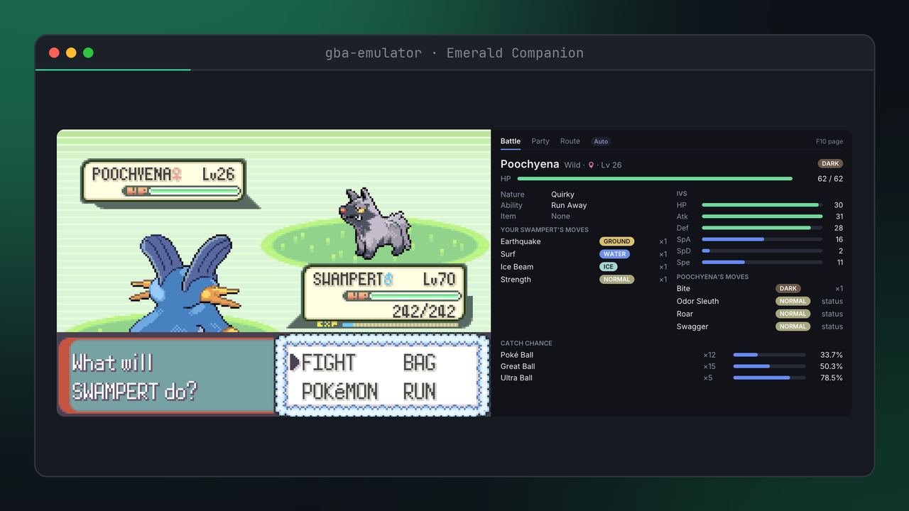
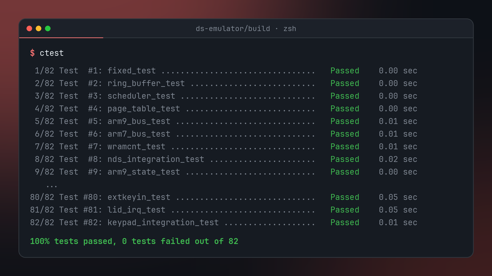
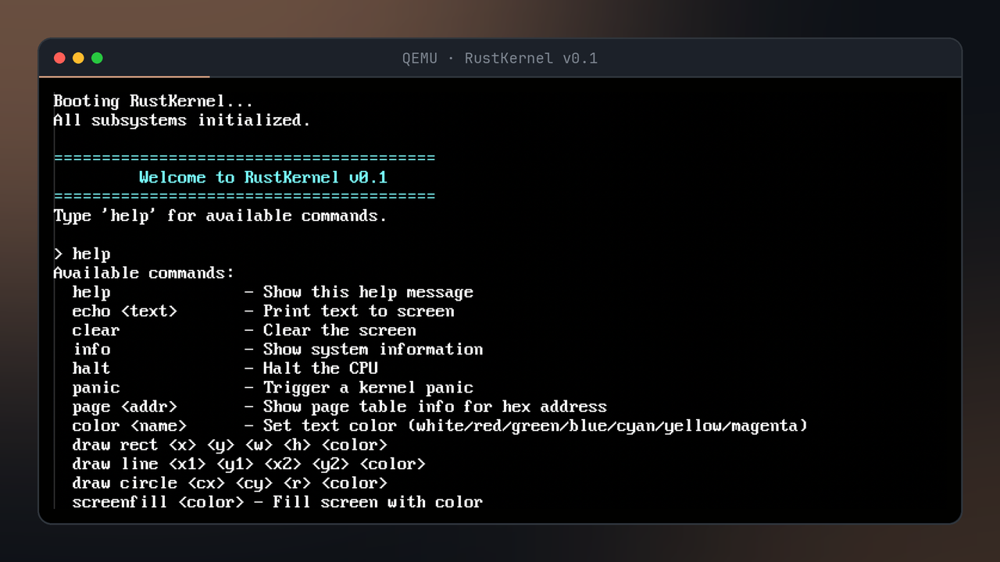
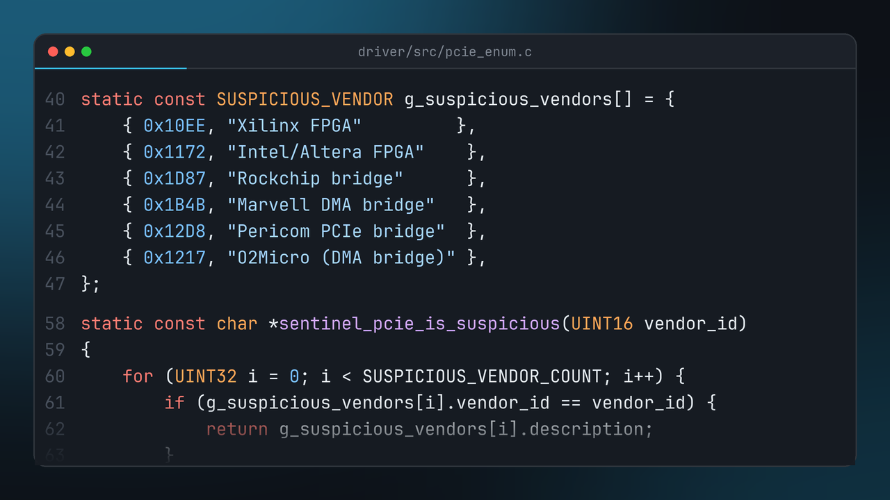
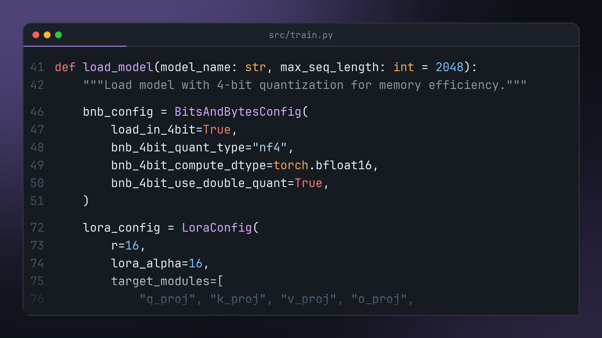
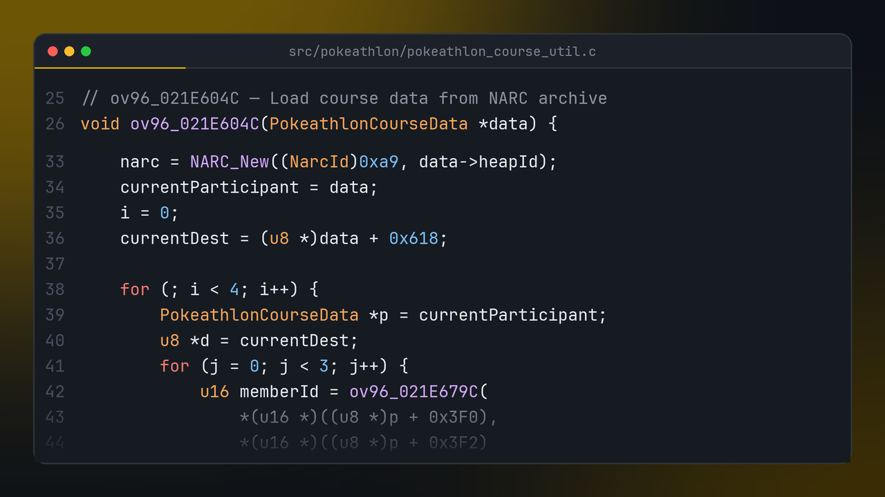

# Hi there! 

  

## 🚀 About Me
👨‍💻 I'm a **Software Engineer**, and I create **JOY** with code! 😸
🏗️ I build **beautiful, accessible** applications and websites ☄️

💡 Passionate about **tech, open source**, and **creative problem-solving**
🥾 In my free time, you'll find me **bodybuilding** or gaming 🎮
🌍 I've traveled to **20+ countries**—Ask me about my adventures! 🏞️  

---

## 🛠️ Tech Stack & Tools

---

## 📌 Projects

<table>
<tr>
<td width="50%" valign="top">

<h3><a href="https://github.com/amyanger/gba-emulator">gba-emulator</a></h3>
A Game Boy Advance emulator in C, built around Pokémon Emerald. The Emerald Companion panel reads the game live and shows battle damage, catch odds, party stats, encounters and a Nuzlocke tracker, and Hardware X-Ray lets you watch the CPU, PPU and audio at work.
  

</td>
<td width="50%" valign="top">

<h3><a href="https://github.com/amyanger/ds-emulator">ds-emulator</a></h3>
A Nintendo DS emulator written from scratch in C++20, aimed at the Gen 4 and Gen 5 Pokémon games with HeartGold and SoulSilver first. Two CPUs on separate buses driven by one event scheduler. Still early, with the CPUs and core hardware coming first.
  

</td>
</tr>
<tr>
<td width="50%" valign="top">

<h3><a href="https://github.com/amyanger/rust-kernel">rust-kernel</a></h3>
A bare-metal x86_64 kernel in Rust. It has interrupts, 4-level paging, a heap allocator, framebuffer graphics with a bitmap font, and an interactive shell, and it boots in QEMU.
  

</td>
<td width="50%" valign="top">

<h3><a href="https://github.com/amyanger/sentinel">sentinel</a></h3>
A Windows anticheat aimed at DMA cheat hardware. A kernel driver checks PCIe devices and memory timing for FPGA boards, a C++ service watches processes and loaded modules, and a web dashboard shows what it finds.
  

</td>
</tr>
<tr>
<td width="50%" valign="top">

<h3><a href="https://github.com/amyanger/local-llm-project">local-llm-project</a></h3>
QLoRA fine-tuning for 7B models on one consumer GPU. 4-bit quantization keeps training to about 16 GB of VRAM, and it supports the RTX 5090 (Blackwell).
  

</td>
<td width="50%" valign="top">

<h3><a href="https://github.com/amyanger/pokeheartgold">pokeheartgold</a></h3>
My fork of the pret HeartGold/SoulSilver decompilation. I'm turning the Pokéathlon course code (overlay 96) back into C that compiles to the original bytes.
  

</td>
</tr>
</table>

<picture>
  <source media="(prefers-color-scheme: dark)" srcset="https://raw.githubusercontent.com/amyanger/amyanger/output/github-snake-dark.svg" />
  <source media="(prefers-color-scheme: light)" srcset="https://raw.githubusercontent.com/amyanger/amyanger/output/github-snake.svg" />
  
</picture>
